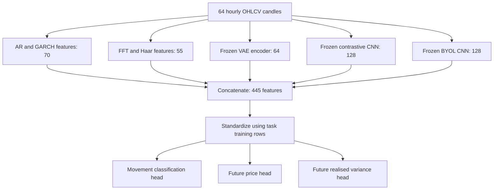
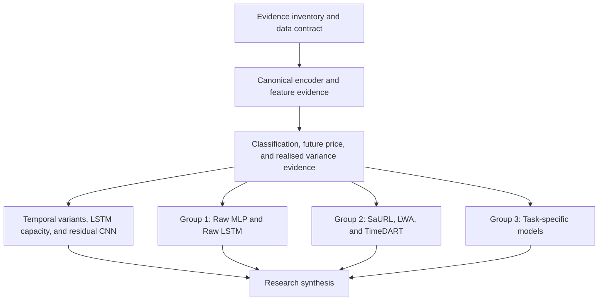

# A Unified Representation Learning Framework for Multi-Task Time-Series Modeling in Event Prediction Markets

**Report:** End to End Research Progress Report  
**Date:** 11 October 2026  
**Status:** First draft for supervisor review

## Executive Summary

This project investigates whether features extracted from historical prediction-market prices and trading volumes can support several forecasting tasks. The framework combines statistical features, signal transformations, and pretrained neural features. Its neural encoders are trained before downstream prediction and then frozen. Separate prediction heads use the extracted features to predict movement direction, a future price, and future realised variance.

The research motivation is that financial applications ask several questions of the same historical observations. A supervised model learns features while optimizing a selected target. Those features may be useful for other targets, but this needs to be evaluated. Previous financial research has used representation learning both to improve label construction and to learn features for downstream applications. This project focuses on feature extraction and reuse under fixed target definitions.

The project has completed the full experimental loop: data preparation, encoder pretraining, frozen feature extraction, downstream prediction, and matched baseline evaluation. The experiments use two chronological calendar walks, each with its own training data, encoder weights, preprocessing, and prediction heads. Within each walk, the same pretrained encoders support all three tasks through lightweight heads.

The baseline comparisons are organized into three groups: vanilla Raw MLP and Raw LSTM, existing self-supervised representation-learning frameworks for general time series, and task-specific models. These groups evaluate the framework against direct raw-input learning, other reusable representations, and specialized forecasting systems respectively.

The results provide encouraging evidence for this reusable representation approach. H0 and the strongest observed internal variants achieve higher movement-classification macro-F1 than Raw MLP, Raw LSTM, SGN-C, SaURL, and LWA in both walks. The strongest variants reach macro-F1 **0.453953 and 0.458697**, placing them behind only TimeDART among the methods evaluated on the original classification rows. For eight-hour future price, H0 reduces MAE by **13.4% to 45.4%** relative to the three external frozen representations. The strongest observed internal price variants extend those reductions to **24.9% to 52.6%** and also have lower RMSE than all three. For future realised variance, H0 has lower MAE than SaURL, LWA, Raw LSTM, and the GARCH--LSTM stack in both walks.

These findings show that the extracted features contain useful information for several financial targets, rather than serving only one prediction task. Controlled encoder additions also improve future-price error over H0, including a contrastive residual-CNN addition that improves on its duplicate-feature control in both walks. TimeDART's classification and variance MAE advantages, and the stronger price errors of specialized systems, identify where further refinement can help. Detailed comparisons are reported by task below.

The completed evidence is organized in a Lumid FlowMesh workflow with 19 audit nodes. It demonstrates the data contracts, model evidence, comparisons, and final synthesis using existing reports. It does not retrain models or execute prediction. Canonical single-branch and leave-one-branch-out ablations remain a later analysis stage for the final report.

## 1 Research Motivation and Story

### 1.1 Why Financial Features Matter

Historical prices and trading volumes describe how a market has changed. Researchers use these observations for several purposes. Price forecasting concerns a future price level. Movement classification concerns whether the price will rise, remain approximately unchanged, or fall. Volatility forecasting concerns the size of future fluctuations.

These tasks use the same market history, but success on one task does not establish success on another. For example, two market conditions can have a similar expected price change but very different variability. A model that predicts the average change accurately may still be unable to distinguish them.

Features are the values supplied to a prediction model. They may be raw observations, calculated summaries, or outputs from a trained encoder. A representation is a collection of such features describing the input. The choice of representation matters because it affects which properties are available to the downstream prediction model and how easily that model can use them.

| Forecasting question | Information the model needs to predict |
|---|---|
| What will the contract price be eight hours later? | Future price level |
| Will the contract price rise, remain stable, or fall over two hours? | Direction relative to a specified movement threshold |
| How much will the contract price fluctuate over the next eight hours? | Magnitude of future price changes |

These are the three current evaluation tasks. They are related, but their targets and losses are different.

### 1.2 What Existing Feature Methods Offer

Statistical methods describe selected properties of the observations. For example, an autoregressive model summarizes dependence on recent values, while a GARCH model describes conditional variation. These methods provide explicit assumptions and fitted summaries. Their usefulness depends on how well those assumptions and summaries suit the task.

Signal transformations provide another description of a sequence. Fourier analysis expresses it through frequency components. Wavelet analysis describes variation at different scales. A transformation reorganizes existing information; it does not create additional observations.

Supervised neural models learn features while being trained to predict a selected target. This can produce strong task-specific models. However, their training loss rewards success on that target. It does not directly measure whether the learned features will also help another task.

Representation pretraining separates at least part of feature learning from the final prediction task. An encoder can first be trained through reconstruction, contrastive learning, or auxiliary objectives. Its output can then be supplied to a downstream model. The usefulness of that output must be tested rather than assumed.

For example, Ying and colleagues' SMART framework learns stock-sequence embeddings through auxiliary tasks concerning sequence discrimination, price co-movement, and volume co-movement. Those embeddings are then used for stock-trend prediction. This provides a concrete example of learning features with objectives beyond the final directional prediction loss. [SMART, Neurocomputing, 2024](https://www.sciencedirect.com/science/article/pii/S0925231223011566)

### 1.3 Why Financial Target Definitions Need Attention

A prediction target must specify what is being predicted and when. For movement classification, researchers must also specify what counts as a meaningful increase or decrease. Different horizons and thresholds produce different labels from the same price series.

A small price movement can be important in a quiet period and less informative in an active period. Noise can also affect whether an observation is assigned to an upward, stable, or downward class. These issues motivate research on label construction.

They also matter when evaluating features: a representation useful for one target definition may perform differently under another. However, label uncertainty alone does not establish that reusable representations will solve the problem. Label construction and feature extraction need to be considered separately.

### 1.4 Two Ways Representation Learning Has Been Used

**Improving labels.** Ma, Ventre, and Polukarov use a denoising autoencoder to reconstruct smoothed prices, with moving-average series as reconstruction targets. They calculate returns from the reconstructed prices, generate movement labels using thresholds, and train an SVM classifier. Their experiments cover daily S&P 500 prices, one-minute Bitcoin prices, and high-frequency Google order-book data. The learned reconstruction supports label construction before classification. [Denoised Labels, Sections 4 and 5](https://arxiv.org/html/2112.10139v1)

The authors report higher F1 scores under their denoised-label scheme. Both training and evaluation labels are changed, so the comparison concerns the new labeling scheme. It does not establish better prediction of the original unsmoothed labels. This distinction matters when identifying what the method addresses.

**Improving features.** Zhong, Lin, and Yang's LOBench studies representations of limit-order-book data. Encoders are trained through reconstruction, then paired with simple downstream models for price-trend prediction and missing-data imputation. The authors also test freezing the pretrained encoder and training only the downstream models. Their reported frozen-encoder performance is comparable to joint training in that experiment, with more training epochs. Here, reconstruction trains a feature extractor rather than generating replacement movement labels. [LOBench, Section 4.2](https://arxiv.org/html/2505.02139v1#S4.SS2)

Dolphin, Smyth, and Dong learn asset embeddings from historical returns. Return similarity across time windows is used to choose positive and negative asset pairs. Contrastive training draws similar assets together in the embedding space and separates dissimilar assets. The embeddings are evaluated for industry classification and portfolio hedging. Different losses perform differently across those applications, illustrating why downstream usefulness must be measured separately. [Contrastive Asset Embeddings, Sections 3 and 4](https://arxiv.org/html/2407.18645v1)

Wang, Ma, and Cohen's SSPT uses stock-code classification, sector classification, and moving-average prediction as pretraining tasks before stock selection. These are stock-specific learning objectives, including metadata supervision. The study provides another example of learning features before the final financial application; it is not evidence that all useful pretraining must be label-free. [SSPT, KDD 2025](https://arxiv.org/abs/2506.16746)

| Approach | What changes | What downstream evaluation examines |
|---|---|---|
| Learned denoising for labels | The prices used to construct labels and therefore the labels themselves | Prediction under the revised labeling scheme |
| Reconstruction pretraining for features | The encoder output supplied to a downstream model | Whether those features support downstream tasks |
| Contrastive pretraining for features | The embedding learned from selected relationships between examples | Whether those relationships are useful for the evaluated applications |

Label improvement and feature improvement address different parts of prediction and can be used together. A useful representation does not repair a poorly defined target, and a suitable target does not ensure that a model learns useful features.

### 1.5 What This Project Investigates

This project focuses on feature extraction and reuse. It uses fixed definitions for movement classification, future price, and future realised variance. The targets are constructed from the accepted price data rather than from a learned denoised reconstruction.

The neural encoders are trained before the task heads. Within each chronological walk, their weights are frozen and reused across the three tasks. Each task has its own prediction head, trained on its eligible training rows.

The central question is therefore concrete: can these shared features support useful predictions for several tasks, and how well do they perform compared with suitable baselines? Attaching several heads establishes that reuse is possible in the implementation. Comparing their predictions establishes how useful that reuse is.

Pretraining also has limitations. Reconstruction can encourage an encoder to preserve details that do not help forecasting. Contrastive objectives depend on the choice of examples and augmentations. Features learned without the downstream labels can still be poorly suited to a particular task.

### 1.6 Why Combine Different Representations

The framework includes several methods because they use different assumptions and learning objectives. Their inclusion is a hypothesis to evaluate.

| Feature method | Reason for including it |
|---|---|
| AR and GARCH | Explicit fitted summaries of local dependence and conditional variation |
| FFT and Haar wavelet | Frequency content and variation at different scales |
| Variational autoencoder | Features learned through reconstruction with latent regularization |
| Contrastive encoder | Features learned by agreement between augmented views and discrimination between examples |
| BYOL encoder | Features learned by prediction between online and target networks using augmented views |

These methods may provide overlapping information. Combining them can also increase input width and the number of downstream parameters. A wider feature vector alone is not evidence of better information.

Sun and colleagues combine time-domain and frequency-domain components for stock prediction and report improvements in their evaluated setting. This supports investigating multiple feature views, while leaving their usefulness on prediction-market data to be tested. [StockMixer with ATFNet, Scientific Reports, 2025](https://www.nature.com/articles/s41598-025-14872-6)

The completed encoder studies compare substitutions at the same feature width and additions against duplicate-feature controls. The later ablation analysis will examine the canonical branches individually and in combinations. This will help assess whether combining them adds predictive value beyond using individual branches.

### 1.7 Why Use Prediction Markets

Prediction markets were selected as the evaluation domain for this broader representation question. Binary event contracts have bounded traded prices and finite lifetimes. Their histories can contain long quiet periods, sudden changes, and uneven trading activity. A contract can also spend substantial time near zero or one.

These characteristics make evaluation important. A forecast can be close to the eventual price simply because the current price is already close. A strong correlation between predicted and observed price levels can therefore coexist with weak prediction of future changes. Movement diagnostics help assess whether the model captures information about subsequent price changes.

Earlier prediction-market research gives a reason to study price history. Sung and colleagues examine relationships between historical odds trends and errors in market-implied event probabilities in betting-exchange markets. Their study shows that historical price behavior can be informative in that setting. Its target is event-probability accuracy, whereas our tasks concern future traded prices and their changes. [Sung et al., European Journal of Operational Research, 2019](https://www.sciencedirect.com/science/article/pii/S0377221718305575)

The reviewed financial representation studies establish useful precedents, but they do not directly answer how a common combination of statistical, transformed, and neural features performs across our prediction-market tasks. Our contribution is to evaluate that question using documented data rules, chronological comparisons, and simple downstream heads.

### 1.8 Research Questions and Contributions

**RQ1: Representation effectiveness and complementarity.** Can the evaluated features support useful prediction, and does combining feature methods add predictive value? The completed raw-input, external-representation, and controlled encoder comparisons address effectiveness and selected additions. Canonical branch contributions will be examined in the later ablation analysis.

**RQ2: Representation reuse.** Can the same frozen encoders support several forecasting tasks, and how competitive are the resulting predictions compared with suitable baselines? Reuse is assessed within each walk. Each walk trains its own encoders; transferring an earlier walk's encoder to a later walk is outside these experiments.

The contributions are a working heterogeneous feature framework, demonstrated reuse across three prediction-market forecasting tasks, and matched evidence of its predictive value relative to raw-input, external-representation, and specialized models. The later ablation stage will explain how the canonical branches contribute to these results.

The scientific value comes from answering these questions through controlled comparisons. For example, a representation can remain useful for classification while a specialized price model achieves lower forecasting error. Explaining that difference is more informative than assigning one overall rank across unrelated tasks.

## 2 Methodology and Model Architecture

### 2.1 From Historical Observations to Predictions

Each input contains 64 consecutive hourly candles with five channels: open, high, low, close, and volume. The canonical framework, called **H0**, extracts five named branches and concatenates their outputs into 445 features.

The design brings explicit statistical summaries, frequency and scale information, and pretrained neural features into one reusable input. Concatenation gives the downstream heads access to all five branches. Keeping the heads lightweight makes this a direct way to evaluate how useful the extracted features are for each task.



**Figure 1.** Canonical architecture within one walk. The frozen encoder weights are shared across tasks. Each task fits its own downstream scaler and head using only its training rows.

| Branch | Construction | Width |
|---|---|---:|
| Statistical | Per OHLCV channel: five AR coefficients, two residual statistics, and seven GARCH features | 70 |
| Transformed | Per channel: eight FFT magnitudes and three Haar detail-energy features | 55 |
| VAE | Latent mean from the walk's frozen epoch-50 encoder | 64 |
| Contrastive | Frozen CNN backbone output | 128 |
| BYOL | Frozen online CNN backbone output | 128 |
| Concatenation | All five branches | **445** |

AR and GARCH parameters are fitted within each input window. These are deterministic window-local feature calculations, rather than neural pretraining. FFT and Haar features are also calculated directly. The VAE, contrastive CNN, and BYOL CNN require pretraining.

### 2.2 Encoder Pretraining

The canonical matrix contains three neural encoders for each of two walks, giving six independent trajectories. They consume training contexts selected without requiring future task labels. This separates encoder-data eligibility from the later requirement that a supervised target exists and has matured.

The VAE learns through reconstruction and a KL-divergence penalty. The contrastive CNN uses NT-Xent on augmented views. BYOL trains an online network to predict a target-network representation, with the target updated by an exponential moving average. The downstream features come from the backbone or latent mean, not from the training-only projection or prediction heads.

The canonical recipes use AdamW, learning rate 0.001, weight decay 0.0001, batch size 256, and seed 0. Each encoder completes one 50-epoch trajectory with retained snapshots at epochs 5, 15, and 50. Epoch 50 is fixed for feature extraction. The VAE latent width is 64; both CNN outputs have width 128. Augmentations for the contrastive and BYOL encoders include scaling, jitter, and time masking.

All six trajectories are complete and replay-valid, providing the frozen neural encoders for the full downstream evaluation. Training losses and embedding diagnostics describe optimization and representation health; downstream results measure predictive usefulness.

### 2.3 Frozen Features and Task Heads

Frozen features are stored with row identities and source/checkpoint hashes. The downstream scaler uses only the task's training features. Each coordinate is standardized using its training mean and standard deviation, with a fixed floor for near-zero variance and clipping to the interval [-10, 10]. Evaluation features use the saved scaler.

The canonical heads use hidden widths 128 and 64. Classification produces three logits. Future-price prediction produces a sigmoid-bounded scalar. Realised-variance prediction uses a nonnegative Softplus output. The three tasks train separate heads; the encoder weights do not change during head training.

This separation makes feature reuse concrete: after pretraining, each task uses the saved encoders and fits its own scaler and small head. The completed results therefore evaluate a common representation on direction, future price, and future fluctuation magnitude without fitting a new neural encoder for each target.

The model input remains five-channel OHLCV. Imputation masks and time-since-observation values are retained for eligibility checks and reporting. In the accepted source artifacts, imputed candles have zero raw volume and observed candles have positive raw volume, so the volume channel provides an implicit missingness signal before normalization. No additional mask or time-since channel is included.

Architecture and recipe sources: [canonical encoder amendment](../docs/phase_plan/2026-09-21-phase-5-encoder-pretraining-amendment.md), [feature and downstream amendment](../docs/phase_plan/2026-09-21-phase-5-feature-and-framework-downstream-amendment.md), [future-price amendment](../docs/phase_plan/2026-09-21-phase-5-absolute-price-h8-amendment.md), and [realised-variance matrix freeze](../docs/phase_plan/2026-09-25-phase-6-volatility-model-matrix-freeze.md).

## 3 Experimental Methods and Design

### 3.1 Data Source and Cleaning

The primary experiments use two independently acquired top-50 FinData cohorts of Polymarket conditions at native one-hour resolution. Eligibility probes for cohort selection use each walk's training interval, and selected conditions are downloaded through its evaluation end. Full-lifetime catalog information remains a retrospective selection limitation.

The acquisition audit found that condition-level candles can mix complementary YES and NO prices. The approved quarantine rule removes flagged observations while preserving immutable raw files and leaving their timestamps as gaps. The experiments accept the final pruning as correct offline cleaning. They do not replay the cleaning decision according to the time at which its confirmation became available.

Only complete isolated missing hours are filled. A filled candle has flat OHLC at the preceding observed close and zero volume. Longer gaps break sequences. Filled candles may occur in historical context, but decision and target endpoints must be observed. The realised-variance target additionally requires every close in its future path to be observed.

These are explicit research assumptions. Training and evaluation separation is enforced within the accepted cleaned data; this does not make the cohort selection or offline cleaning a fully prospective live-acquisition procedure. [Canonical data authority](../docs/phase_plan/2026-09-21-phase-5-experiment-plan.md)

### 3.2 Chronological Walks and Data Populations

A calendar walk has one common training cutoff across all pooled contracts. Preprocessing and weights are fitted from that walk's permitted training history, followed by evaluation in the next interval. This avoids training a pooled model on later calendar observations from one contract and evaluating it on earlier observations from another.

| Walk | Training interval in UTC | Evaluation interval in UTC | Selected conditions | Encoder-training rows |
|---:|---|---|---:|---:|
| 1 | 2 Dec 2025 to before 1 Apr 2026 | 1 Apr 2026 to before 16 Jun 2026 | 50 | 39,070 |
| 2 | 16 Feb 2026 to before 16 Jun 2026 | 16 Jun 2026 to before 1 Sep 2026 | 50 | 58,473 |

The selected conditions do not all contribute eligible sequences. Each task also has different target requirements, so its sample counts differ.

| Population | Walk 1 train | Walk 1 evaluation | Walk 2 train | Walk 2 evaluation |
|---|---:|---:|---:|---:|
| Two-hour movement classification | 37,864 | 30,340 | 57,521 | 13,887 |
| Eight-hour future price | 36,773 | 29,834 | 56,652 | 13,506 |
| Eight-hour future realised variance | 32,470 | 27,806 | 53,112 | 12,115 |
| TA-eligible classification intersection | 30,043 | 25,821 | 49,243 | 10,923 |

For the classification population, 47 conditions contribute training rows and 23 contribute evaluation rows in Walk 1; the corresponding counts are 43 and 27 in Walk 2. Future-price evaluation contains 23 and 25 conditions, and realised-variance evaluation contains 23 and 25. Sample counts describe overlapping windows, not independent markets or events.

Evaluation can use historical context before the cutoff when that history would already be available at prediction time. Training targets must mature before the cutoff. Evaluation targets must mature before the evaluation end. A causal activity rule requires at least one nonzero close change in the preceding 24 hourly intervals. Contract lifecycle is a reporting stratum rather than the primary split.

Counts are recorded in the [Walk 1 classification manifest](../experiments/phase5/data_preparation/walk1/market_1h_seq64_h2.npz.manifest.json), [Walk 2 classification manifest](../experiments/phase5/data_preparation/walk2/market_1h_seq64_h2.npz.manifest.json), [price manifests](../experiments/phase5/downstream_addons/shared/h8/data/), and [realised-variance manifests](../experiments/phase6/volatility_prediction/data_preparation/).

### 3.3 Targets and Metrics

Let p(t) denote the observed close at the decision point. All horizons below are measured on the hourly grid, with candle availability checked separately from its recorded start timestamp.

| Task | Fixed target | Main reported metrics |
|---|---|---|
| Movement classification | DOWN if p(t+2h)-p(t) < -0.001; STABLE if its absolute value is at most 0.001; UP if it exceeds 0.001 | Macro-F1 and balanced accuracy; accuracy and class-level diagnostics support interpretation |
| Future price | p(t+8h) | MAE and RMSE; implied-movement Spearman and timestamp Rank IC |
| Future realised variance | Sum of eight squared hourly price changes over (t,t+8h] | MAE and RMSE; MSE and correlation diagnostics |

The classification threshold is an absolute price change of 0.001, equivalent to 0.1 probability percentage point. It is not a 0.1% return relative to the starting price.

Realised variance is defined as:

```text
RV(t,8h) = sum for j = 1,...,8 of [p(t+jh) - p(t+(j-1)h)]^2
```

It measures future path variation, not only the squared endpoint change. The target is in raw squared-price units and is not log-return variance, annualized volatility, or the standard deviation of a historical window. During neural optimization, it is multiplied by 10,000 and trained with Smooth L1 loss. Predictions are converted back before reporting errors. H=8 was frozen after a training-target audit of candidate horizons, using evaluation capacity rather than model performance.

For future price, the implied movement is the predicted future price minus the current close. Spearman measures ordering across saved observations. Timestamp Rank IC measures the ordering of implied and observed movements across contracts at the same time, under the report's minimum support rule. These diagnostics are distinct from price-level error.

### 3.4 Three Baseline Groups

The baseline design answers three questions in order: how the framework compares with learning directly from raw data, how it compares with existing reusable representations, and how it compares with models trained for individual tasks.

| Group | Baselines | Question addressed |
|---|---|---|
| **1. Vanilla raw-input models** | Raw-OHLCV MLP and Raw LSTM | Do extracted features provide useful predictions compared with supervised learning directly from OHLCV? |
| **2. Existing self-supervised representation-learning frameworks for general time series** | SaURL-TS-Frozen, LWA-Frozen, and TimeDART-Frozen | How competitive is the proposed representation under a common frozen-feature evaluation? |
| **3. Task-specific models** | TA-MLP and SGN-C for classification; XM-C8 for future price; GARCH--LSTM for realised variance | Can one reusable representation remain competitive with systems trained for individual tasks? |

#### Group 1: Vanilla Raw-Input Models

Raw MLP learns from flattened OHLCV contexts. Raw LSTM learns from their sequential structure. Each baseline is trained separately for each task and walk. They provide the basic comparison with the proposed feature-extraction approach on identical task rows.

#### Group 2: Existing Self-Supervised Representation-Learning Frameworks

SaURL-TS learns adaptive time- and frequency-domain views using BYOL-style objectives. LWA aligns time, Fourier, and wavelet representations and learns mappings between their embeddings. TimeDART combines autoregressive patch prediction with denoising. These methods learn features before downstream prediction and can support several tasks, making this group the closest comparison to the project's representation-reuse objective. Their original studies cover different time-series domains; here they are adapted to the same prediction-market tasks. [SaURL method note](../docs/baselines/SaURL_TS/paper_reading_note.md), [LWA method note](../docs/baselines/LWA/paper_reading_note.md), [TimeDART method note](../docs/baselines/TimeDART/paper_reading_note.md)

Each adapted encoder is pretrained separately within each walk, frozen, and evaluated through the common lightweight task-head pattern. Native widths are retained: H0 has 445 coordinates, SaURL 128, LWA 384, and TimeDART 170, so head parameter counts differ. SaURL and LWA form the required external comparison; TimeDART is the completed exploratory extension. The comparison evaluates frozen-feature usefulness under this project's protocol.

#### Group 3: Task-Specific Models

TA-MLP uses 36 causal technical indicators for classification. SGN-C is the supervised classification adaptation with its native head. XM-C8 is the supervised xLSTM-Mixer adaptation for the eight-hour future-price endpoint. GARCH--LSTM combines conditional-variance and neural forecasts for the future-realised-variance target. These are complete-system comparisons with the reusable framework.

TA-MLP requires additional indicator history, so its comparison uses the TA-eligible intersection and matched H0, Raw MLP, and Raw LSTM reruns. Its sampling sensitivity is reported separately. GARCH--LSTM uses chronological out-of-fold training predictions for its meta-features, keeping the stack's fitting separate from evaluation outcomes.

The always-STABLE reference accompanies classification. Internal encoder substitutions, additions, and duplicate-feature controls are reported as framework analysis in Section 5.4.

### 3.5 Controlled Encoder Experiments

The temporal matrix contains H0, four LSTM/Transformer substitutions, four heterogeneous additions, and two duplicate-CNN controls. A substitution replaces one 128-dimensional neural branch, preserving the total width of 445. An addition retains the canonical branches and adds 128 coordinates, producing width 573. A duplicate control copies the corresponding CNN coordinates to reach the same width without adding an independent representation.

The duplicate controls help examine whether gains arise only from wider downstream inputs. They are imperfect capacity controls because their copied coordinates are exactly collinear. The follow-up capacity studies test two-layer LSTM encoders across all three tasks and residual CNN encoders for future price only.

Centered linear CKA compares the similarity of representations on permitted training identities. It is a descriptive diagnostic. A low CKA value establishes a difference between embeddings, not better prediction or complementary information.

### 3.6 Training and Evidence Rules

Each reported experiment uses independently fitted walk-specific models. Fitted preprocessing and downstream feature scalers use training observations only. No evaluation gradients update a representation or a head.

The current experiments use train/test allocation without a validation split or early stopping. They retain epochs 5, 15, and 50 from one trajectory, with epoch 50 fixed as the principal snapshot within each experiment. Classification uses training-prior logit-adjusted cross-entropy under the primary protocol. Future-price H0 uses endpoint MSE, and neural realised-variance models use the scaled Smooth L1 contract.

Source identities, hashes, saved checkpoints, predictions, and metrics are retained. Standalone validators have checked the completed artifacts, so the reported results can be traced to their data, weights, and saved outputs.

The studies developed in rounds, using earlier observations to guide specific follow-up questions. Each later recipe was fixed before its execution. For example, the endpoint-only XM-C8 benchmark aligned the specialized price model with the framework's eight-hour future-price target.

## 4 Completed Evidence and Lumid Demonstration

### 4.1 Completed Experimental Scope

| Study | Completed evidence | Purpose |
|---|---|---|
| Canonical framework | Six neural encoder trajectories, two 445-dimensional stores, and completed task heads across both walks | Establish the working feature-to-prediction loop |
| Temporal encoder matrix | Eight temporal encoder trajectories; 66 task/walk/configuration entries, comprising 60 new runs and six H0 references | Compare substitutions, additions, and width controls |
| LSTM capacity | Four two-layer encoders and 24 downstream trajectories | Examine a bounded change in encoder capacity |
| Residual CNN capacity | Four encoders and eight price trajectories | Examine deeper CNN features for future price |
| Group 1: vanilla raw-input models | Completed Raw MLP and Raw LSTM task trajectories across both walks | Compare with direct supervised learning from OHLCV |
| Group 2: existing self-supervised frameworks | Six walk-specific representation fits, six stores, 18 downstream trajectories, and 54 downstream snapshots | Compare SaURL, LWA, and TimeDART under frozen probes |
| Group 3: task-specific models | Completed causal TA-MLP comparisons, SGN-C classification, XM-C8 price, and GARCH--LSTM variance stacks | Assess competitiveness against specialized systems |

The counts describe completed work within each named study. The reports reuse the same saved H0 and raw-model references where task contracts match, keeping the comparisons consistent across studies. [Current project status](../docs/schedule.md)

### 4.2 What the Lumid Workflow Demonstrates

The FlowMesh workflow presents the completed research evidence in one dependency graph. It inspects a frozen bundle of reports and metrics, checks its packaged integrity, passes audit outputs between nodes, and generates a task-separated synthesis.

Its seven presentation groups are shown below. They summarize the 19 nodes in the implemented workflow and follow the three baseline groups used in this report.



**Figure 2.** Simplified presentation of the evidence workflow. The [actual 19-node YAML](../workflows/flowmesh_research_audit.yaml) contains additional dependencies between individual audit nodes.

| Presentation group | Nodes covered | Evidence displayed |
|---|---|---|
| Evidence and data contract | Inventory and data contract | Walk boundaries, target populations, preprocessing and source records |
| Canonical framework | Encoders, features, classification, price, realised variance | Recorded pretraining, feature stores, and H0 task results |
| Encoder studies | Temporal variants, LSTM capacity, residual CNN | Controlled comparisons, CKA, and resources |
| Group 1: vanilla raw-input models | Raw baselines | Matched Raw MLP and Raw LSTM results |
| Group 2: existing self-supervised frameworks | SaURL, LWA, TimeDART | Frozen-probe comparisons |
| Group 3: task-specific models | TA-MLP, SGN-C, XM-C8, GARCH--LSTM | Matched comparisons for individual tasks |
| Synthesis | Research synthesis | Joined results and descriptive differences |

The audit image packages 915 evidence files. The documented local image verification passed all 19 nodes and produced 260 normalized result rows and 212 matched comparisons. On 10 October 2026, the project owner reported that all 19 nodes passed on FlowMesh and supplied a screenshot. Direct independent inspection of the platform's returned metrics and artifact bundle remains outstanding. [Workflow implementation and evidence record](../workflows/README.md)

The workflow contains reports and scalar evidence, not the training datasets, feature arrays, predictions, or model weights. Training and prediction replay are prior recorded evidence. Although nodes request GPU workers, the audit itself inspects reports on CPU. Lumid demonstrates how the completed evidence is organized and checked; it supplies no additional model-performance result.

### 4.3 End to End Evidence Trace

A supervisor can follow one completed task through its artifacts:

1. The walk manifest identifies the permitted source history and the training/evaluation boundaries.
2. The data bundle identifies the 64-hour contexts, decision points, and mature targets.
3. Encoder records identify the training population and frozen epoch-50 weights.
4. Feature records connect those weights and deterministic calculations to the task rows.
5. The task run records the training-only scaler, head, checkpoint, and predictions.
6. The comparison report evaluates those predictions against methods using the same task population.
7. The Lumid synthesis displays the recorded results and their comparison scope.

This is a demonstration of the completed experimental loop. No new training, inference, or replay is required for the supervisor demonstration.

## 5 Experimental Results

All tables below use the fixed epoch-50 snapshot and the task definitions in Section 3.3. The comparisons follow the three groups introduced in Section 3.4, with results for each task within each group. Higher classification scores are better; lower regression errors are better.

The tables show both **canonical H0** and the **best observed internal variants** where their evaluation rows match. H0 records the unchanged reference representation reused across tasks. The variant row reports the strongest observed result for each metric and walk among the completed encoder substitutions and additions, with the supplying configuration named in each cell. Different cells can refer to different configurations. Raw baselines and duplicate-feature controls are excluded from this row. The TA-intersection table retains its own matched H0 results.

Configuration names identify the changes: `HC` uses contrastive learning and `HB` uses BYOL; `S` denotes substitution and `A` addition; `L` denotes LSTM and `T` Transformer. `HB-SL2` is the two-layer BYOL LSTM substitution. Variant values were checked against the [temporal matrix](../experiments/phase6/encoder_variants/reports/complete_seed0/epoch50_by_walk.csv), [LSTM-capacity matrix](../experiments/phase6_5/lstm_capacity/reports/complete_seed0/epoch50_by_walk.csv), and [residual-CNN matrix](../experiments/phase6_5/residual_cnn/reports/complete_seed0/epoch50_by_walk.csv).

The main achievements are summarized first, followed by the detailed task results.

| Area | Positive evidence | Research implication |
|---|---|---|
| Feature reuse | The same frozen encoders support classification, future price, and future realised variance within each walk | One pretrained feature pipeline can serve several targets through separate lightweight heads |
| Movement classification | H0 and its strongest variants exceed Raw MLP, Raw LSTM, SGN-C, SaURL, and LWA on macro-F1 in both walks; only TimeDART is ahead on the original rows | The representation retains useful directional information |
| Future price | The strongest internal price variants have 24.9%–52.6% lower MAE and 5.7%–41.8% lower RMSE than the three external frozen representations | The heterogeneous framework is competitive against recent representation methods under the common-probe protocol |
| Future realised variance | H0 has lower MAE than SaURL, LWA, Raw LSTM, and GARCH--LSTM in both walks | The reused features also support prediction of future fluctuation magnitude |
| Encoder refinement | Contrastive residual-CNN substitution and addition reduce price MAE/RMSE in both walks; addition also beats its duplicate-feature control | The modular design allows tested improvements to the extracted features |

### 5.1 Group 1: Vanilla Raw-Input Models

This group compares H0 and the strongest observed internal variants with the two basic supervised baselines, Raw MLP and Raw LSTM. All methods use the same eligible rows within each task and walk. It establishes how the extracted features compare with learning directly from historical OHLCV.

#### Movement Classification

| Method | Walk 1 macro-F1 | Walk 1 balanced accuracy | Walk 2 macro-F1 | Walk 2 balanced accuracy |
|---|---:|---:|---:|---:|
| Canonical H0 | 0.453469 | 0.465787 | 0.453202 | 0.489162 |
| Best observed internal variants | 0.453953 (`HB-SL2`) | 0.469034 (`HB-SL2`) | 0.458697 (`HB-ST`) | 0.495388 (`HC-ST`) |
| Raw MLP | 0.444806 | 0.460938 | 0.432459 | 0.457089 |
| Raw LSTM | 0.425204 | 0.469376 | 0.446326 | 0.484626 |

**Canonical H0 exceeds both raw models on macro-F1 in both walks.** Its gains over Raw LSTM are 2.83 percentage points in Walk 1 and 0.69 percentage point in Walk 2; its gains over Raw MLP are 0.87 and 2.07 percentage points. H0 also exceeds both raw models on balanced accuracy in Walk 2. Raw LSTM has a small balanced-accuracy lead in Walk 1.

The strongest internal variants improve macro-F1 further, to **0.453953** in Walk 1 and **0.458697** in Walk 2. Their gains over Raw LSTM are 2.87 and 1.24 percentage points, respectively. The strongest variant balanced accuracy is also higher than both raw models in Walk 2; Raw LSTM retains a small lead in Walk 1.

STABLE accounts for approximately 74% of evaluation rows, so macro-F1 and balanced accuracy are the main metrics. An always-STABLE classifier has macro-F1 of approximately 0.2828 and 0.2839, calculated from the saved class counts, and balanced accuracy of 0.3333. H0's higher values on both metrics show useful class discrimination beyond always predicting the majority class. The always-STABLE accuracy is 0.736585 and 0.741629, above H0's 0.647956 and 0.612659; that comparison illustrates why accuracy alone does not capture directional classification value.

#### Eight-Hour Future Price

| Method | Walk 1 MAE | Walk 1 RMSE | Walk 2 MAE | Walk 2 RMSE |
|---|---:|---:|---:|---:|
| Canonical H0 | 0.007985399 | 0.018905834 | 0.010053535 | 0.030072603 |
| Best observed internal price variants | 0.006933 (`HC-AL`) | 0.015184 (`HC-AL`) | 0.007888 (`HB-AL`) | 0.024590 (`HB-AL`) |
| Raw MLP | 0.006865453 | 0.015613174 | 0.011125242 | 0.023487550 |
| Raw LSTM | 0.004500579 | 0.012151731 | 0.006541574 | 0.022129913 |

The strongest price variants improve on H0's MAE and RMSE in both walks. Against Raw MLP, they have lower RMSE in both walks and lower MAE in Walk 2. Walk 1 MAE is close: Raw MLP achieves 0.006865453 versus the variant's 0.006933342, approximately a 1.0% difference. Raw LSTM has lower MAE and RMSE in both walks. The representation's future-price output also contains useful movement-ranking information:

| Learned method | Walk 1 implied-movement Spearman | Walk 2 implied-movement Spearman |
|---|---:|---:|
| H0 | 0.147363 | 0.099988 |
| Raw MLP | 0.146817 | 0.058693 |
| Raw LSTM | 0.263878 | 0.146491 |

H0's implied movements have positive Spearman correlation in both walks. Its values are slightly above Raw MLP in Walk 1 and higher in Walk 2. This adds evidence of task-relevant information beyond predicting the price level, with Raw LSTM providing a stronger sequential reference.

#### Eight-Hour Future Realised Variance

| Method | Walk 1 MAE | Walk 1 RMSE | Walk 2 MAE | Walk 2 RMSE |
|---|---:|---:|---:|---:|
| H0 | 0.000626190 | 0.025583491 | 0.000502040 | 0.009858725 |
| Best observed internal variants | 0.000625186 (`HB-ST`) | 0.025581775 (`HB-SL2`) | 0.000504746 (`HC-AL`) | 0.009857093 (`HB-AT`) |
| Raw MLP | 0.000627437 | 0.025545443 | 0.000496373 | 0.009855126 |
| Raw LSTM | 0.000666902 | 0.025585498 | 0.000540722 | 0.009814025 |

**H0 has 6.1% and 7.2% lower MAE than Raw LSTM** in Walks 1 and 2 respectively. H0 and Raw MLP have similar MAE: H0 is slightly lower in Walk 1 and Raw MLP is slightly lower in Walk 2. RMSE ordering differs from MAE. Taken together with classification and price, these results show that the same frozen features remain useful across different prediction targets.

The strongest internal variant improves Walk 1 MAE slightly further, to 0.000625186. In Walk 2, canonical H0's MAE is lower than that of every tested internal encoder variant. Reporting both rows shows where refinement helps and where the original representation remains stronger.

Sources: [matched Phase 5 report](../experiments/phase5/baselines/reports/baseline_matrix_seed0/summary.md), [Raw MLP price metrics, Walk 1](../experiments/phase5/baselines/tasks/absolute_price_h8/raw_ohlcv_mlp/walk1/seed0/e50/metrics.json), [Walk 2](../experiments/phase5/baselines/tasks/absolute_price_h8/raw_ohlcv_mlp/walk2/seed0/e50/metrics.json), and [current-round realised-variance report](../experiments/phase6/volatility_prediction/reports/initial_neural_seed0/report.md).

### 5.2 Group 2: Existing Self-Supervised Representation-Learning Frameworks

This is the direct comparison with existing frameworks that learn reusable representations for general time-series data. SaURL, LWA, and TimeDART are adapted to prediction-market OHLCV, pretrained within each walk, frozen, and evaluated on the same three targets using the common task-head pattern.

#### Movement Classification

| Method | Walk 1 macro-F1 | Walk 1 balanced accuracy | Walk 2 macro-F1 | Walk 2 balanced accuracy |
|---|---:|---:|---:|---:|
| Canonical H0 | 0.453469 | 0.465787 | 0.453202 | 0.489162 |
| Best observed internal variants | 0.453953 (`HB-SL2`) | 0.469034 (`HB-SL2`) | 0.458697 (`HB-ST`) | 0.495388 (`HC-ST`) |
| SaURL-Frozen | 0.429292 | 0.463001 | 0.450317 | 0.488291 |
| LWA-Frozen | 0.403129 | 0.468943 | 0.449673 | 0.483677 |
| TimeDART-Frozen | **0.473548** | **0.487778** | **0.466718** | **0.498915** |

**The strongest internal variants exceed SaURL and LWA on both macro-F1 and balanced accuracy in both walks.** TimeDART retains the lead, but its macro-F1 margin over these variants is **1.96 percentage points in Walk 1 and 0.80 percentage point in Walk 2**. Canonical H0 also exceeds SaURL and LWA on macro-F1 in both walks. The variant row makes the improved balanced-accuracy comparison visible as well.

#### Eight-Hour Future Price

**Future-price MAE provides the strongest advantage over the existing self-supervised frameworks.** Even the unchanged canonical H0 has lower MAE than SaURL, LWA, and TimeDART in both walks.

| Frozen representation | Walk 1 MAE | Walk 1 RMSE | Walk 2 MAE | Walk 2 RMSE |
|---|---:|---:|---:|---:|
| Canonical H0 | 0.007985399 | 0.018905834 | 0.010053535 | 0.030072603 |
| Best observed internal price variants | 0.006933 (`HC-AL`) | 0.015184 (`HC-AL`) | 0.007888 (`HB-AL`) | 0.024590 (`HB-AL`) |
| SaURL-Frozen | 0.009226 | 0.017709 | 0.013524 | 0.031302 |
| LWA-Frozen | 0.012594 | 0.023817 | 0.015669 | 0.028236 |
| TimeDART-Frozen | 0.014638 | 0.026109 | 0.013745 | 0.026081 |

The price variant row describes two completed configurations: the contrastive LSTM addition (`HC-AL`) in Walk 1 and the BYOL LSTM addition (`HB-AL`) in Walk 2. Both MAE and RMSE are lower than those of SaURL, LWA, and TimeDART in each walk. These configurations reduce MAE by **24.9%–52.6%** and RMSE by **5.7%–41.8%** relative to the external representations. H0 alone reduces MAE by **13.4%–45.4%**. Its RMSE comparison is mixed, making MAE the clearest canonical advantage.

The common price population contains 29,834 evaluation rows in Walk 1 and 13,506 in Walk 2. External-method values are shown at their published report precision.

#### Eight-Hour Future Realised Variance

| Frozen representation | Walk 1 MAE | Walk 1 RMSE | Walk 2 MAE | Walk 2 RMSE |
|---|---:|---:|---:|---:|
| H0 | 0.000626190 | 0.025583491 | 0.000502040 | 0.009858725 |
| Best observed internal variants | 0.000625186 (`HB-ST`) | 0.025581775 (`HB-SL2`) | 0.000504746 (`HC-AL`) | 0.009857093 (`HB-AT`) |
| SaURL | 0.000647110 | 0.025586692 | 0.000535907 | 0.009821329 |
| LWA | 0.000654246 | 0.025588726 | 0.000516424 | 0.00980773 |
| TimeDART | 0.000608884 | 0.025584718 | 0.000481353 | 0.009848405 |

**H0 and the strongest internal variants also remain competitive on future realised variance.** Both have lower MAE than SaURL and LWA in both walks. The strongest variant has the lowest RMSE in Walk 1; in Walk 2, the external representations have slightly lower RMSE. Differences among these frozen representations remain below 0.6%. TimeDART has the lowest MAE, approximately 2.6% below the strongest variant in Walk 1 and 4.1% below the stronger canonical H0 in Walk 2. This is encouraging evidence that the shared features support fluctuation forecasting as well as price and direction.

Across the three tasks, the proposed framework compares favorably with SaURL and LWA on macro-F1 and MAE. Its largest advantage is future-price MAE, where it also improves on TimeDART. This group therefore provides clear evidence of competitiveness against other reusable representation methods. [Integrated frozen-representation comparison](../experiments/phase6_7/reports/frozen_representation_seed0/summary.md)

### 5.3 Group 3: Task-Specific Models

This group compares H0 with systems trained for individual tasks: SGN-C and TA-MLP for classification, XM-C8 for future price, and GARCH--LSTM for future realised variance. These comparisons assess complete forecasting systems. Raw-model values are repeated where helpful as references from Group 1.

#### Movement Classification: SGN-C

| Method | Walk 1 macro-F1 | Walk 1 balanced accuracy | Walk 2 macro-F1 | Walk 2 balanced accuracy |
|---|---:|---:|---:|---:|
| Canonical H0 | 0.453469 | 0.465787 | 0.453202 | 0.489162 |
| Best observed internal variants | 0.453953 (`HB-SL2`) | 0.469034 (`HB-SL2`) | 0.458697 (`HB-ST`) | 0.495388 (`HC-ST`) |
| SGN-C | 0.398941 | 0.442285 | 0.313716 | 0.356374 |

H0 has higher macro-F1 and balanced accuracy than SGN-C in both walks. The macro-F1 gains are 5.45 percentage points in Walk 1 and 13.95 percentage points in Walk 2. This shows that the reusable representation remains competitive with the evaluated supervised classification adaptation. SGN-C's learned hard grouping assigns all five variables together in this adaptation; the detailed diagnostic is retained in the source report. [Task-specific synthesis](../experiments/phase6_9/reports/task_specific_competitiveness_seed0/summary.md)

The strongest internal variants extend the macro-F1 gains over SGN-C to 5.50 and 14.50 percentage points. Together with Groups 1 and 2, the original-row classification comparison places the strongest internal variants ahead of all evaluated models except TimeDART on macro-F1.

#### Movement Classification: TA-MLP

TA-MLP uses 36 technical indicators, which require enough preceding history to calculate. Only samples where all indicators are available enter this comparison. H0, Raw MLP, Raw LSTM, and TA-MLP are retrained on the same reduced training datasets and evaluated on the same 25,821 test samples in Walk 1 and 10,923 in Walk 2. All four use the same training loss, adjusted for class imbalance using training class frequencies; test samples retain their natural class distribution. This training procedure is called P2 in the experiment records.

The encoder variants were evaluated on the original classification rows and have no matched TA-intersection reruns. Their scores therefore remain in the original-row tables above.

| Method on the same training and test samples | Walk 1 macro-F1 | Walk 1 balanced accuracy | Walk 2 macro-F1 | Walk 2 balanced accuracy |
|---|---:|---:|---:|---:|
| H0 | 0.447668 | 0.456570 | 0.463227 | 0.495129 |
| Raw MLP | 0.421119 | 0.419676 | 0.442052 | 0.459017 |
| Raw LSTM | 0.426742 | 0.463734 | 0.455453 | 0.485961 |
| TA-MLP | 0.480952 | 0.524718 | 0.456409 | 0.467769 |

H0 exceeds Raw MLP and Raw LSTM on macro-F1 in both walks of this additional matched comparison. In Walk 2, it also exceeds TA-MLP on both macro-F1 and balanced accuracy, leading all four models. TA-MLP leads in Walk 1. The result supports the usefulness of the learned heterogeneous features alongside established technical indicators.

The TA-only P1U sampling sensitivity gives macro-F1 0.483489 in Walk 1 and 0.448849 in Walk 2. It does not produce a consistent improvement over primary TA/P2. [TA and GARCH--LSTM principal report](../experiments/phase6_5/reports/b_c_seed0/principal_results.md)

#### Eight-Hour Future Price: XM-C8

| Method | Walk 1 MAE | Walk 1 RMSE | Walk 2 MAE | Walk 2 RMSE |
|---|---:|---:|---:|---:|
| Canonical H0 | 0.007985399 | 0.018905834 | 0.010053535 | 0.030072603 |
| Best observed internal price variants | 0.006933 (`HC-AL`) | 0.015184 (`HC-AL`) | 0.007888 (`HB-AL`) | 0.024590 (`HB-AL`) |
| Raw LSTM | 0.004500579 | 0.012151731 | 0.006541574 | 0.022129913 |
| XM-C8 | 0.003100233 | 0.011040398 | 0.004759289 | 0.020759157 |

XM-C8 predicts the same eight-hour endpoint using the original price rows. It has lower MAE and RMSE than H0, the strongest internal price variants, and Raw LSTM in both walks. The variants improve substantially on H0, while Raw LSTM and XM-C8 remain stronger learned price systems. These results provide useful targets for price-focused refinement of the framework.

| Learned method | Walk 1 implied-movement Spearman | Walk 2 implied-movement Spearman |
|---|---:|---:|
| H0 | 0.147363 | 0.099988 |
| Raw LSTM | 0.263878 | 0.146491 |
| XM-C8 | 0.328457 | 0.259229 |

H0 retains positive movement-ranking information, while XM-C8 gives stronger ordering of future movements. The ranking results concern predictive information; trading profitability is outside this experiment. [Endpoint-only model comparison](../experiments/phase6_9/xlstm_mixer_endpoint/reports/seed0/summary.md)

#### Eight-Hour Future Realised Variance: GARCH--LSTM

| Method | Walk 1 MAE | Walk 1 MSE | Walk 2 MAE | Walk 2 MSE |
|---|---:|---:|---:|---:|
| H0 | 0.000626190 | 0.000654515 | 0.000502040 | 0.000097194 |
| Best observed internal variants | 0.000625186 (`HB-ST`) | 0.000654427 (`HB-SL2`) | 0.000504746 (`HC-AL`) | 0.000097162 (`HB-AT`) |
| Raw LSTM | 0.000666902 | 0.000654618 | 0.000540722 | 0.000096315 |
| GARCH--LSTM stack | 0.000960824 | 0.000654354 | 0.001470010 | 0.000096312 |

**The framework achieves the lowest MAE in this matched comparison:** the strongest internal variant leads in Walk 1 and canonical H0 leads in Walk 2. H0 alone has **34.8% and 65.8% lower MAE than GARCH--LSTM**, in Walks 1 and 2 respectively. H0 also has higher Spearman than the stack. The stack has marginally lower MSE, so the clearest framework advantage concerns average absolute error. MAE is in realised-variance units; MSE is in squared realised-variance units. [Strict stack comparison](../experiments/phase6_5/reports/b_c_seed0/principal_results.md)

The strongest internal variant reduces Walk 1 MAE slightly further than H0, while H0 retains the lowest framework MAE in Walk 2. Both framework rows have lower MAE than Raw LSTM and GARCH--LSTM in both walks.

The task-specific comparisons show that a shared representation can compete successfully with several specialized systems, particularly for classification and realised-variance MAE. The specialized price result identifies a concrete opportunity for further framework refinement.

### 5.4 Internal Framework Analysis: Encoder Substitution and Capacity

The encoder studies demonstrate a practical strength of the framework: feature methods can be changed or added while retaining the same task definitions and evaluation workflow. Several completed refinements improve predictive performance.

| Completed study | Main observation | Interpretation |
|---|---|---|
| LSTM/Transformer substitution and addition | Several configurations improve price errors; selected substitutions improve Walk 2 classification | Temporal features offer a useful refinement, especially for future price |
| Two-layer LSTM capacity | Completed under both SSL families with 24 downstream trajectories; its BYOL substitution supplies the highest observed internal Walk 1 classification macro-F1, 0.453953 | A small classification gain, showing that additional depth has a limited effect in this comparison |
| Contrastive residual CNN | Substitution and addition reduce price MAE/RMSE versus H0 in both walks; addition also improves on its duplicate-width control | Evidence for the named price-only comparison beyond input width alone |
| BYOL residual CNN | Price-error changes differ across walks | The contrastive objective provides the clearer result for this capacity change |

The contrastive residual-CNN result is especially useful for the representation question. Both substitution and addition reduce MAE and RMSE relative to H0 in both walks, and the addition also improves on the same-width duplicate control. Across the combined evaluation rows, the addition reduces MAE by **8.45% versus H0** and **10.82% versus the duplicate control**; pooled RMSE falls by **14.67% and 17.93%**, respectively. This supports a predictive benefit for the added representation beyond simply copying existing features. The improvement concerns price error; movement Rank IC does not improve overall. [Residual-CNN report](../experiments/phase6_5/residual_cnn/reports/complete_seed0/summary.md)

The temporal LSTM additions in Section 5.2 provide another concrete improvement: future-price MAE falls from H0's 0.007985 to 0.006933 in Walk 1 and from 0.010054 to 0.007888 in Walk 2, approximately 13.2% and 21.5% reductions respectively. These are two named configurations, reported as evidence about encoder choices. [Integrated comparison](../experiments/phase6_7/reports/frozen_representation_seed0/summary.md)

The temporal encoders have centered linear CKA values approximately 0.17 to 0.30 against their same-family CNNs. Their embeddings differ, but the downstream comparisons are required to assess whether that difference helps. [Temporal outcome analysis](../docs/phase_plan/2026-09-26-phase-6-experiment-observation-and-outcomes.md)

### 5.5 What the Target Exploration Contributed

The earlier target experiments helped identify a more useful way to evaluate the representation. Direct raw-change and log-return regression produced correlations close to zero across the framework and raw models. The eight-hour future-price probe, in contrast, produced positive implied-movement ranking in both walks. This motivated the current separation of price-level error and movement-ranking diagnostics.

In the pooled Phase 5 report, H0's mean timestamp Rank IC is positive at 0.126384, compared with 0.208024 for Raw LSTM. Exploration also identified a causal last-hour reversal score with Rank IC 0.279444 on the same rows. Together, these observations provide useful directions for later signal analysis, with profitable trading outside the completed scope. [Matched Phase 5 report](../experiments/phase5/baselines/reports/baseline_matrix_seed0/summary.md)

## 6 Discussion and Remaining Analysis

### 6.1 What the Completed Results Establish

The project has progressed from a research idea to a complete, demonstrable experimental framework. Documented source data lead to pretrained encoders, frozen features, lightweight task heads, saved predictions, matched comparisons, and a Lumid evidence workflow. The same canonical encoder weights support all three tasks within each walk.

For RQ1, the completed comparisons show predictive value in the heterogeneous representation. The strongest internal variants exceed Raw MLP, Raw LSTM, SGN-C, SaURL, and LWA on original-row classification macro-F1; only TimeDART is ahead. For future price, the strongest variants have lower MAE and RMSE than all three external frozen representations in both walks. They also improve on Raw MLP's RMSE in both walks and MAE in Walk 2, while Raw MLP has a small Walk 1 MAE advantage. The framework's realised-variance MAE improves on the raw sequential and hybrid references. The controlled residual-CNN additions give concrete evidence that refining a representation can improve price prediction beyond a duplicate-feature control.

For RQ2, the shared frozen features support several targets without training a separate encoder for each target. This reuse is demonstrated through evaluated predictions, not only through the implementation of multiple heads. Classification and realised-variance comparisons show that a reusable representation can compete successfully with several task-specific systems. The positive movement-ranking results add evidence that its future-price output contains information about later changes.

The main achievement is therefore a reusable feature framework with demonstrated predictive strengths across the three tasks, together with a controlled way to improve and analyze its components. Specialized price models provide useful targets for the next refinement stage, while canonical branch ablation will explain which parts of the shared representation contribute to the observed performance.

### 6.2 Scope of Interpretation

The report evaluates forecasting from historical OHLCV under the accepted cohort-selection and offline-cleaning rules. Event text, news, order books, and explicit resolution-time information are possible future inputs. The findings concern the documented prediction-market data and task definitions.

The external comparison evaluates project adaptations using frozen features and a common head pattern at each representation's native width. The task-specific comparison evaluates complete systems. Keeping those comparison types explicit helps explain both the framework's strengths and the remaining opportunities for improvement. Trading profitability and the individual contribution of every canonical branch are separate research questions.

### 6.3 Later Ablation Analysis

The planned canonical ablation study will compare each of the five branches individually, the full concatenation, and combinations that leave out one branch. It will cover the three current tasks using the documented task populations.

This analysis will ask which branches are useful alone and whether removing a branch changes the combined model's predictive performance. Because input widths and head parameter counts vary, the results will be interpreted as operational predictive contributions rather than causal feature importance.

Ablation is documented but not implemented or executed. It will form a later analysis part of the final report and research paper. SHAP-style attribution is separately deferred and requires a defined sampling and estimator protocol; it will not substitute for matched ablation comparisons.

### 6.4 Progress and Next Work

The canonical loop, temporal studies, bounded capacity studies, external frozen comparisons, and task-specific competitiveness round are complete for their defined scopes. Expanded subgroup and contract-macro reporting remains a follow-up for parts of the completed benchmark work.

The next reporting step is to review this draft's research argument and the presentation of each comparison. The supervisor demonstration can then use the completed FlowMesh evidence and the task tables without rerunning experiments. The later presentation can shorten the motivation while retaining the distinctions between label improvement, feature learning, reuse, and predictive competitiveness.

Future experiment priorities remain separate decisions. Canonical ablation is frozen but unexecuted; raw-fusion and decoder-capacity studies are deferred; the additional recent-representation extension is optional and unimplemented. None is reported here as a completed result. Profitable-alpha research also remains outside the completed scope.

## Appendix A Research Evidence Index

| Evidence | Location |
|---|---|
| Revised motivation article | [Research motivation article](final_research_motivation_report_2026.md) |
| Current progress and roadmap | [Schedule](../docs/schedule.md), [research plan](../docs/research_plan.md) |
| Canonical data and training authority | [Phase 5 plan](../docs/phase_plan/2026-09-21-phase-5-experiment-plan.md) |
| Full temporal matrix | [Temporal encoder report](../experiments/phase6/encoder_variants/reports/complete_seed0/report.md) |
| LSTM capacity evidence | [Capacity report](../experiments/phase6_5/lstm_capacity/reports/complete_seed0/summary.md) |
| Residual-CNN evidence | [Price-only capacity report](../experiments/phase6_5/residual_cnn/reports/complete_seed0/summary.md) |
| TA and strict GARCH--LSTM | [Principal benchmark report](../experiments/phase6_5/reports/b_c_seed0/principal_results.md) |
| Group 1: vanilla raw-input comparisons | [Matched raw baseline report](../experiments/phase5/baselines/reports/baseline_matrix_seed0/summary.md), [future-realised-variance report](../experiments/phase6/volatility_prediction/reports/initial_neural_seed0/report.md) |
| Group 2: existing self-supervised frameworks | [Integrated representation report](../experiments/phase6_7/reports/frozen_representation_seed0/summary.md) |
| Best observed internal variant values | [Temporal matrix CSV](../experiments/phase6/encoder_variants/reports/complete_seed0/epoch50_by_walk.csv), [LSTM-capacity CSV](../experiments/phase6_5/lstm_capacity/reports/complete_seed0/epoch50_by_walk.csv), [residual-CNN CSV](../experiments/phase6_5/residual_cnn/reports/complete_seed0/epoch50_by_walk.csv) |
| Group 3: task-specific results | [Task-separated synthesis](../experiments/phase6_9/reports/task_specific_competitiveness_seed0/summary.md) |
| Endpoint-only price amendment | [XM-C8 authority](../docs/phase_plan/2026-10-09-phase-6-9-xlstm-endpoint-amendment.md) |
| Lumid demonstration | [Workflow documentation](../workflows/README.md), [19-node workflow](../workflows/flowmesh_research_audit.yaml), [frozen evidence inventory](../workflows/research_audit_evidence_manifest.json) |
| Later canonical ablation | [Phase 7A plan](../docs/phase_plan/2026-09-26-phase-7a-representation-ablation-plan.md) |

## Appendix B Literature Cited

1. Ying, Z., Cheng, D., Chen, C., et al. (2024). Predicting stock market trends with self-supervised learning. Neurocomputing, 568, 127033. [Publisher article](https://www.sciencedirect.com/science/article/pii/S0925231223011566).
2. Ma, Y., Ventre, C., and Polukarov, M. (2022; preprint 2021). Denoised Labels for Financial Time-Series Data via Self-Supervised Learning. ACM ICAIF. [Paper](https://arxiv.org/abs/2112.10139).
3. Zhong, M., Lin, Y., and Yang, P. (2025). Representation Learning of Limit Order Book: A Comprehensive Study and Benchmarking. [Paper](https://arxiv.org/abs/2505.02139).
4. Dolphin, R., Smyth, B., and Dong, R. (2024). Contrastive Learning of Asset Embeddings from Financial Time Series. ACM ICAIF. [Paper](https://arxiv.org/abs/2407.18645).
5. Wang, M., Ma, T., and Cohen, S. B. (2025). Pre-training Time Series Models with Stock Data Customization. ACM KDD. [Paper](https://arxiv.org/abs/2506.16746).
6. Sun, W., Mei, J., Liu, S., Yuan, C., and Zhao, J. (2025). Research on deep learning model for stock prediction by integrating frequency domain and time series features. Scientific Reports, 15, 30386. [Paper](https://www.nature.com/articles/s41598-025-14872-6).
7. Sung, M.-C., McDonald, D. C. J., Johnson, J. E. V., Tai, C.-C., and Cheah, E.-T. (2019). Improving prediction market forecasts by detecting and correcting possible over-reaction to price movements. European Journal of Operational Research, 272(1), 389–405. [Publisher article](https://www.sciencedirect.com/science/article/pii/S0377221718305575).
