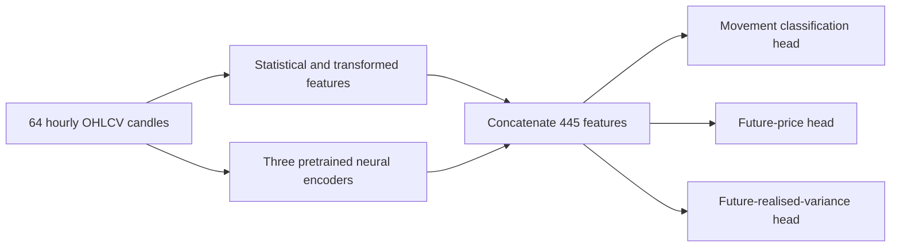
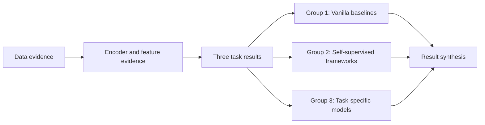

# A Unified Representation Learning Framework for Multi-Task Time-Series Modeling in Event Prediction Markets

**Report:** End-to-End Progress Report — Submission Version  
**Date:** 11 October 2026

## 1. Research Motivation and Story

Financial applications use historical prices and trading volumes to answer several questions: where prices will move, whether a movement is upward or downward, and how much prices will fluctuate. A supervised model learns features for its chosen target. This project investigates whether a shared set of extracted features can support several forecasting tasks through lightweight prediction heads.

### Labels and Features: Two Routes to Better Prediction

Financial labels depend on setting of tasks such as forecasting horizons and rules for distinguishing meaningful predictive information. Researchers can therefore improve prediction through both **better target definitions** and **better features**. Representation learning has been used in both ways:

- **Improving labels:** Ma, Ventre, and Polukarov use a denoising autoencoder to reconstruct smoothed prices, then construct movement labels from reconstructed returns. Their classifier is evaluated under the revised labeling scheme. [Denoised Labels, ICAIF 2022](https://arxiv.org/abs/2112.10139)
- **Improving features:** LOBench trains encoders through reconstruction and evaluates their features for price-trend prediction and missing-data imputation, including frozen-encoder experiments. Dolphin and colleagues learn contrastive asset embeddings from historical return relationships and evaluate them for industry classification and hedging. [LOBench](https://arxiv.org/abs/2505.02139), [Contrastive Asset Embeddings, ICAIF 2024](https://arxiv.org/abs/2407.18645)

These studies show concrete roles for representation learning beyond fitting one final prediction target. Our project focuses on **feature extraction and reuse**, keeping the downstream target definitions fixed.

### Domain and Research Objective

Event prediction markets provide bounded contract prices, finite trading histories, quiet periods, and sudden repricing. They offer a useful setting for evaluating representations developed from historical market observations. The experiments use Polymarket OHLCV data.

The central research question is:

> **Can a shared representation of historical market data capture useful information for different financial prediction tasks?**

We investigate this question in event prediction markets by evaluating feature combination, reuse across tasks, and performance against existing methods.

## 2. Methodology and Model Architecture

The canonical framework, **H0**, takes a 64-hour sequence of open, high, low, close, and volume observations. Five branches extract statistical, transformed, and neural features. Their outputs are concatenated into **445 features**, which are supplied to separate lightweight task heads.

| Feature branch | Width | Reason for inclusion |
|---|---:|---|
| AR and GARCH | 70 | Summarize local dependence, residual behavior, and conditional variation |
| FFT and Haar wavelet | 55 | Describe frequency content and variation at different scales |
| Variational autoencoder | 64 | Learn a compact representation through reconstruction and latent regularization |
| Contrastive CNN | 128 | Learn features through agreement between augmented views and discrimination between examples |
| BYOL CNN | 128 | Learn features through prediction between online and target networks using augmented views |

The methods are combined because they describe the same history through different assumptions and learning objectives. The downstream comparisons test whether these features are useful together.

The VAE, contrastive, and BYOL encoders are pretrained using each walk's training data and then frozen. The same encoder weights are reused across all three tasks within that walk. Each task fits its own training-only feature scaler and a head with hidden widths 128 and 64. Classification produces three classes, price prediction produces a bounded scalar, and realised-variance prediction produces a nonnegative scalar.

### Encoder Variant Experiments

The completed experiments compare the canonical CNN with **four alternative backbone designs**. Each alternative is trained under both **contrastive learning and BYOL**, giving eight alternative encoder types, with independently trained weights for each walk. Every alternative produces 128 features.

| Alternative encoder | Main design | Purpose of comparison | Evaluated tasks |
|---|---|---|---|
| One-layer LSTM | 128 hidden units; final hidden state as the representation | Examine recurrent modeling of temporal dependence | All three tasks |
| Two-layer LSTM | Two recurrent layers of 128 units, with inter-layer dropout | Examine whether greater recurrent depth improves the one-layer representation | All three tasks |
| Transformer | Two layers, four attention heads, and positional encoding | Examine attention-based relationships across the historical context | All three tasks |
| Residual CNN | Three residual convolutional blocks with 128 channels and average pooling | Examine a deeper convolutional representation with skip connections | Future price |

Each alternative is evaluated in two roles:

- **Substitution:** replace the corresponding contrastive or BYOL CNN branch, keeping the combined representation at 445 features. This tests an alternative encoder while retaining the other branches.
- **Addition:** retain all H0 branches and append the alternative encoder's 128 features, giving 573 features. This tests whether the new representation improves prediction alongside the existing features.

For additions, a control duplicates the corresponding canonical CNN features to the same total width of 573. Comparing an addition with both H0 and this control helps assess the predictive value of the new features. The one- and two-layer LSTMs are also compared directly to examine the effect of the deeper recurrent design. [Temporal encoder study](../docs/phase_plan/2026-09-22-phase-6-temporal-encoder-variants-plan.md), [LSTM-capacity and residual-CNN studies](../docs/phase_plan/2026-09-26-phase-6-5-lstm-capacity-and-garch-lstm-plan.md)

## 3. Experimental Scope

The complete data-to-prediction loop has been executed on two chronological walks, each using a separately acquired top-50 cohort of native hourly candles. Training preprocessing and model weights are fitted within each walk. Isolated missing hours are filled, longer gaps break sequences, and decision and target prices are observed.

| Walk | Training interval, UTC | Evaluation interval, UTC |
|---|---|---|
| 1 | 2 Dec 2025 to before 1 Apr 2026 | 1 Apr 2026 to before 16 Jun 2026 |
| 2 | 16 Feb 2026 to before 16 Jun 2026 | 16 Jun 2026 to before 1 Sep 2026 |

| Task | Target | Evaluation rows: Walk 1 / Walk 2 |
|---|---|---:|
| Movement classification | DOWN, STABLE, or UP over two hours, using an absolute price-change threshold of 0.001 | 30,340 / 13,887 |
| Future price | Close price eight hours ahead | 29,834 / 13,506 |
| Future realised variance | Sum of squared hourly price changes over the strictly future eight-hour interval | 27,806 / 12,115 |

The comparisons use three baseline groups:

| Group | Models | Purpose |
|---|---|---|
| **1. Vanilla models** | Raw MLP, Raw LSTM | Compare with supervised learning directly from OHLCV |
| **2. Existing self-supervised frameworks** | SaURL-TS, LWA, TimeDART | Compare reusable representations for general time-series data under common frozen-feature probes |
| **3. Task-specific models** | TA-MLP and SGN-C for classification; xLSTM-Mixer XM-C8 for price; GARCH–LSTM for realised variance | Compare with specialized forecasting systems |

**Reading the results:** epoch 50 is the fixed reporting checkpoint; the experiments use seed 0. Higher macro-F1 and balanced accuracy are better; lower regression errors are better. Macro-F1 is the main classification metric because the classes are imbalanced. Methods share the task rows within each comparison. The TA-MLP comparison uses only samples where all 36 technical indicators can be calculated, with all four models retrained on the same reduced datasets.

## 4. Results and End-to-End Demonstration

### 4.1 Recorded Results

The tables retain the recorded metric values. **H0** is the unchanged canonical framework. **Best variants** reports the strongest completed internal encoder variant for each metric and walk, with its configuration named in the cell. Different cells can refer to different variants.

In configuration names, `HC` means contrastive and `HB` means BYOL; `S` means substitution and `A` addition; `L` means LSTM and `T` Transformer. `HB-SL2` is the two-layer BYOL LSTM substitution. Baseline group numbers follow Section 3.

**Movement classification — original task rows**

| Group | Method | W1 macro-F1 | W1 balanced accuracy | W2 macro-F1 | W2 balanced accuracy |
|---|---|---:|---:|---:|---:|
| Framework | H0 | 0.453469 | 0.465787 | 0.453202 | 0.489162 |
| Framework | Best variants | 0.453953 (`HB-SL2`) | 0.469034 (`HB-SL2`) | 0.458697 (`HB-ST`) | 0.495388 (`HC-ST`) |
| 1 | Raw MLP | 0.444806 | 0.460938 | 0.432459 | 0.457089 |
| 1 | Raw LSTM | 0.425204 | 0.469376 | 0.446326 | 0.484626 |
| 2 | SaURL-Frozen | 0.429292 | 0.463001 | 0.450317 | 0.488291 |
| 2 | LWA-Frozen | 0.403129 | 0.468943 | 0.449673 | 0.483677 |
| 2 | TimeDART-Frozen | 0.473548 | 0.487778 | 0.466718 | 0.498915 |
| 3 | SGN-C | 0.398941 | 0.442285 | 0.313716 | 0.356374 |

**TA-MLP classification — all models trained and tested on the same samples**

Technical indicators require enough preceding history to calculate. This comparison therefore uses 25,821 test samples in Walk 1 and 10,923 in Walk 2. All four models use the same training loss, adjusted for class imbalance using training class frequencies; test samples retain their natural class distribution.

| Method | W1 macro-F1 | W1 balanced accuracy | W2 macro-F1 | W2 balanced accuracy |
|---|---:|---:|---:|---:|
| H0 | 0.447668 | 0.456570 | 0.463227 | 0.495129 |
| Raw MLP | 0.421119 | 0.419676 | 0.442052 | 0.459017 |
| Raw LSTM | 0.426742 | 0.463734 | 0.455453 | 0.485961 |
| TA-MLP, Group 3 | 0.480952 | 0.524718 | 0.456409 | 0.467769 |

**Eight-hour future price**

| Group | Method | W1 MAE | W1 RMSE | W2 MAE | W2 RMSE |
|---|---|---:|---:|---:|---:|
| Framework | H0 | 0.007985399 | 0.018905834 | 0.010053535 | 0.030072603 |
| Framework | Best variants | 0.006933 (`HC-AL`) | 0.015184 (`HC-AL`) | 0.007888 (`HB-AL`) | 0.024590 (`HB-AL`) |
| 1 | Raw MLP | 0.006865453 | 0.015613174 | 0.011125242 | 0.023487550 |
| 1 | Raw LSTM | 0.004500579 | 0.012151731 | 0.006541574 | 0.022129913 |
| 2 | SaURL-Frozen | 0.009226 | 0.017709 | 0.013524 | 0.031302 |
| 2 | LWA-Frozen | 0.012594 | 0.023817 | 0.015669 | 0.028236 |
| 2 | TimeDART-Frozen | 0.014638 | 0.026109 | 0.013745 | 0.026081 |

**Eight-hour future realised variance — raw realised-variance units**

| Group | Method | W1 MAE | W1 RMSE | W2 MAE | W2 RMSE |
|---|---|---:|---:|---:|---:|
| Framework | H0 | 0.000626190 | 0.025583491 | 0.000502040 | 0.009858725 |
| Framework | Best variants | 0.000625186 (`HB-ST`) | 0.025581775 (`HB-SL2`) | 0.000504746 (`HC-AL`) | 0.009857093 (`HB-AT`) |
| 1 | Raw MLP | 0.000627437 | 0.025545443 | 0.000496373 | 0.009855126 |
| 1 | Raw LSTM | 0.000666902 | 0.025585498 | 0.000540722 | 0.009814025 |
| 2 | SaURL | 0.000647110 | 0.025586692 | 0.000535907 | 0.009821329 |
| 2 | LWA | 0.000654246 | 0.025588726 | 0.000516424 | 0.009807731 |
| 2 | TimeDART | 0.000608884 | 0.025584718 | 0.000481353 | 0.009848405 |

**GARCH–LSTM realised-variance comparison — MAE and MSE**

| Method | W1 MAE | W1 MSE | W2 MAE | W2 MSE |
|---|---:|---:|---:|---:|
| H0 | 0.000626190 | 0.000654515 | 0.000502040 | 0.000097194 |
| Best variants | 0.000625186 (`HB-ST`) | 0.000654427 (`HB-SL2`) | 0.000504746 (`HC-AL`) | 0.000097162 (`HB-AT`) |
| Raw LSTM | 0.000666902 | 0.000654618 | 0.000540722 | 0.000096315 |
| GARCH–LSTM, Group 3 | 0.000960824 | 0.000654354 | 0.001470010 | 0.000096312 |

Result sources: [raw model metrics](../experiments/phase5/baselines/tasks/), [raw realised-variance metrics](../experiments/phase6/volatility_prediction/runs/), [frozen-representation comparison](../experiments/phase6_7/reports/frozen_representation_seed0/summary.md), [TA and GARCH–LSTM](../experiments/phase6_5/reports/b_c_seed0/principal_results.md), and [task-specific synthesis](../experiments/phase6_9/reports/task_specific_competitiveness_seed0/summary.md). Variant values come from the completed [temporal](../experiments/phase6/encoder_variants/reports/complete_seed0/epoch50_by_walk.csv) and [LSTM-capacity](../experiments/phase6_5/lstm_capacity/reports/complete_seed0/epoch50_by_walk.csv) matrices.

### 4.2 Lumid Evidence Demonstration

The completed experiment evidence is organized in a **19-node Lumid FlowMesh workflow**. It connects data records, encoder and feature records, task results, baseline comparisons, and a final synthesis. Successful execution of all 19 nodes was reported on 10 October 2026. The demonstration displays completed evidence without replaying training or prediction. [Workflow record and full DAG](../workflows/README.md)

*The diagram groups the recorded audit nodes for presentation.*

### 4.3 Findings in Relation to the Research Question

The experiments provide evidence that **a shared representation of historical market data can capture useful information for different financial prediction tasks** in the evaluated prediction-market setting.

**The extracted features are useful for prediction.** H0 achieves stronger movement classification than the raw-input models on macro-F1 in both walks. It also has lower future-price MAE than all three external representation frameworks and lower realised-variance MAE than Raw LSTM and GARCH–LSTM in both walks. These results support feature extraction as a useful approach to forecasting from market history. The positive relationship between H0's predicted and observed future price changes provides further evidence that its features contain information about subsequent movements.

**The representation can be reused for different financial questions.** Within each walk, the same frozen neural encoders support movement direction, future price, and future fluctuations through separate lightweight prediction heads. Their competitive results across these tasks show that features learned before downstream training can serve several prediction targets. This addresses the research motivation of developing useful features that can be reused without retraining the neural encoders for each task.

**Combining additional representations can improve predictive value.** The contrastive residual-CNN addition lowers future-price MAE and RMSE in both walks compared with H0 and a control that duplicates existing features to the same width. This supports the value of selected additional representations: the improvement suggests that the added features supply useful information beyond the existing feature set. [Controlled addition evidence](../experiments/phase6_5/residual_cnn/reports/complete_seed0/summary.md)

## 5. Future Plan

The next analysis will examine each canonical branch individually and remove one branch at a time from H0. This will show which feature methods are useful alone and which add value to the combined representation across the three tasks. These findings will strengthen the explanation for combining different representations in the final report. [Canonical ablation plan](../docs/phase_plan/2026-09-26-phase-7a-representation-ablation-plan.md)

The research story will then be refined around the demonstrated contributions: reusable features, competitiveness against existing representation methods, and task-dependent benefits of feature diversity. The completed Lumid evidence and concise result tables will support the supervisor presentation, while the detailed methodology and branch analysis will form the final report.
